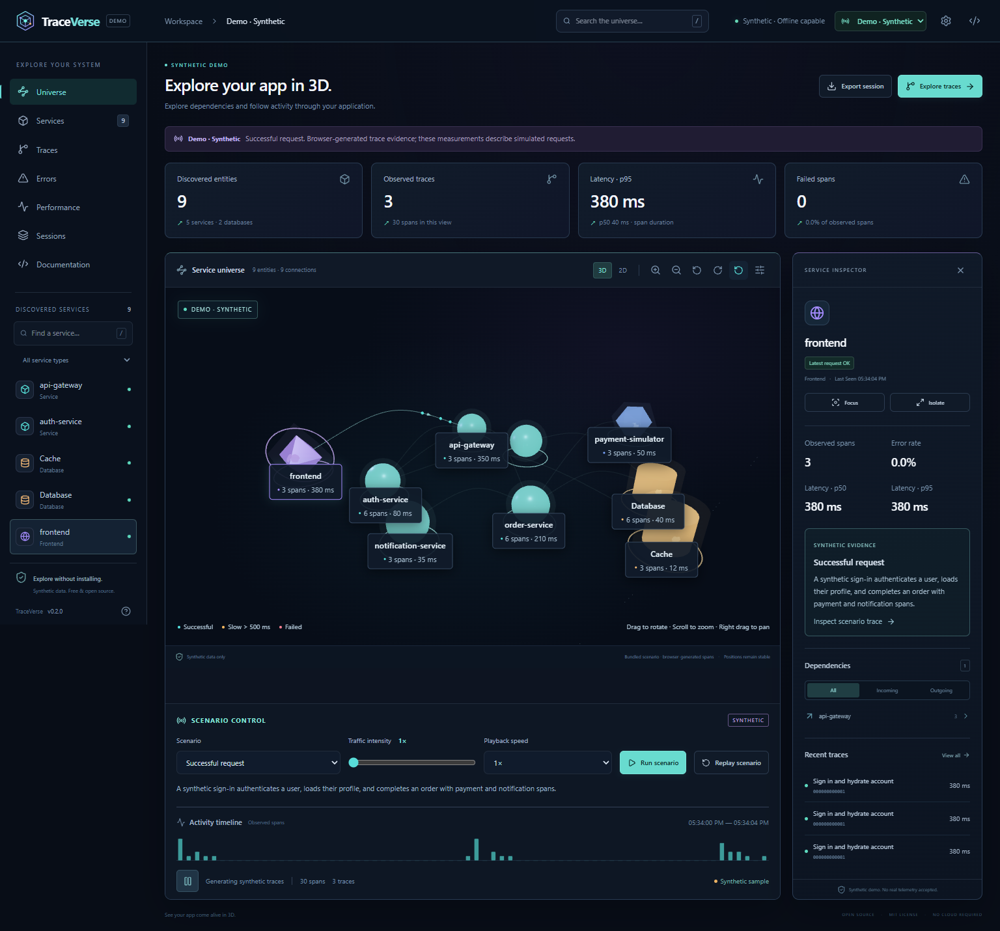
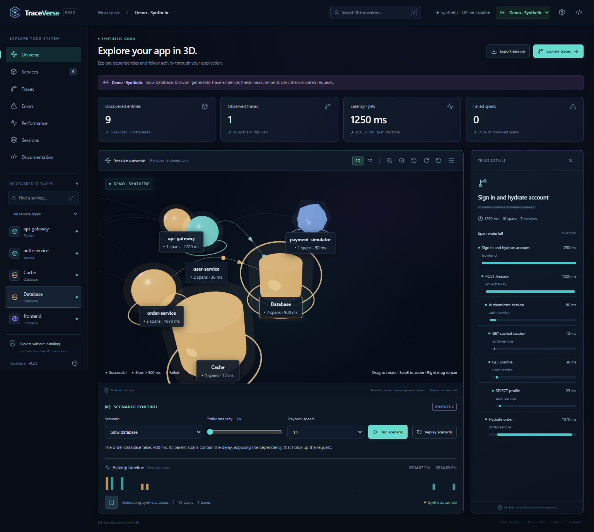
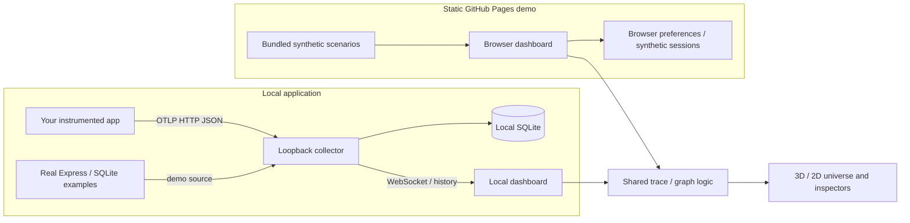

<div align="center">


# TraceVerse — Explore Your App in 3D

**See your app come alive in 3D.**

Free, open-source service graphs and trace inspection, powered by OpenTelemetry.

### [▶ Open the interactive demo](https://prohz189hh-boop.github.io/traceverse/)

**No installation, account, API key, or paid service. Clearly labeled synthetic telemetry.**

[Run locally](#quick-start-with-real-telemetry) · [Connect your app](docs/instrumentation.md) · [Documentation](docs/README.md) · [Contribute](CONTRIBUTING.md)

</div>

TraceVerse turns spans into an interactive service universe. Follow dependencies, select a service, open a trace waterfall, and investigate errors or slow operations. The public GitHub Pages demo lets you explore the interface immediately with bundled synthetic scenarios. The local application keeps the real OpenTelemetry collector, SQLite history, instrumented examples, and session tools on your computer.

## What is new in v0.2.0

- A free browser demo hosted under `/traceverse/`, with shareable hash routes and a separate static build.
- Synthetic sign-in, slow-database, API-failure, heavy-traffic, and recovery scenarios, with adjustable traffic intensity.
- A richer 3D universe: category shapes, directional flowing connections, activity pulses, error/latency highlights, readable labels, selection, and camera controls.
- A responsive control center with Universe, Services, Traces, Errors, Performance, Sessions, and Documentation views.
- Low, balanced, and high graphics presets; balanced by default, reduced motion, bounded data, and an accessible 2D alternative.
- A lazily loaded 3D bundle and rendering that can settle when the scene is idle, paused, or reduced motion is enabled.
- The existing local collector, real Express/SQLite demo, SDK, history, replay, and exports remain available.

Every displayed dependency comes from spans. A database node represents an observed database operation; it is not a database inventory scanner. Recent activity is evidence of observed spans, not a service uptime guarantee.

## Try the browser demo

**[Launch TraceVerse](https://prohz189hh-boop.github.io/traceverse/)**, select a service, and try the scenario controls beneath the universe. Open **Traces** to inspect the hierarchy and duration waterfall, or **Errors** to follow the synthetic API failure. Switch between **3D** and **2D**, adjust quality in **Settings**, or capture a synthetic session and replay it.

The demo contains nine application/dependency entities: frontend, API gateway, auth, users, orders, database, cache, payment simulator, and notifications. All records carry the `synthetic` source. The site runs entirely in your browser; GitHub Pages does not run the collector, example servers, or SQLite. It never connects to your local collector or accepts real telemetry. See [the public demo guide](docs/public-demo.md).

| Where / mode                | Data                                                         | Storage and connection                                         |
| --------------------------- | ------------------------------------------------------------ | -------------------------------------------------------------- |
| Public demo / **Synthetic** | Bundled demonstration spans                                  | Browser only; no collector                                     |
| Local / **Demo**            | Real HTTP calls and SQLite queries from the example services | Local collector and SQLite                                     |
| Local / **Live**            | Your instrumented application's spans                        | Local collector and SQLite                                     |
| Local / **Synthetic**       | Generated interface samples                                  | Browser only                                                   |
| **Replay**                  | Previously recorded spans                                    | Historical view; public replay accepts synthetic sessions only |

## See it in action





These are screenshots of the working application. [Watch the actual browser demonstration](https://github.com/prohz189hh-boop/traceverse/releases/download/v0.2.0/demo-v0.2.webm).

## Quick start with real telemetry

Install **Node.js 24 LTS** and Git, then run:

```sh
git clone https://github.com/prohz189hh-boop/traceverse.git
cd traceverse
npm install
npm run demo
```

Open **http://127.0.0.1:5173**. The command starts the dashboard, the collector at **http://127.0.0.1:4318**, and five real instrumented example services on ports **4600–4604**. Keep the terminal open; `Ctrl+C` stops the processes. [The local demo guide](docs/demo.md) explains deterministic success, slow SQLite, failed-payment, and recovery requests.

Dependencies need internet access during installation. Once installed, the local application requires no cloud account, Docker daemon, separate database server, or paid API.

To connect your own application:

```sh
npm run dev
```

Choose **Live** and follow [the instrumentation guide](docs/instrumentation.md). For a production local build:

```sh
npm run build
npm start
```

Open **http://127.0.0.1:4318**. See [installation and Windows troubleshooting](docs/installation.md) for ports, persistence, and all commands.

To preview the separate public build locally:

```sh
npm run build:demo
npm run preview:demo
```

Open **http://127.0.0.1:4173/traceverse/**. This build writes `apps/web/dist-public` and starts no collector or example services.

## Connect a real application

TraceVerse's SDK uses the official OpenTelemetry Node SDK and **JSON HTTP exporter**. Start tracing before importing the application framework:

```ts
// instrumentation.ts
import { startTracing } from '@traceverse/sdk';

export const tracing = startTracing('my-api', {
  endpoint: 'http://127.0.0.1:4318/v1/traces',
});
```

The helper is a private source workspace, not a registry-published npm package. External applications can use its local folder or the direct official exporter setup in [the integration guide](docs/instrumentation.md).

| Application  | Supported integration boundary                                                  |
| ------------ | ------------------------------------------------------------------------------- |
| Node.js HTTP | Server/client spans from official HTTP instrumentation                          |
| Express      | HTTP spans and Express route/middleware spans; real local multi-service fixture |
| Fastify      | HTTP instrumentation plus the Fastify-owned `@fastify/otel` plugin              |
| Next.js      | Next.js 16.4.0 Node runtime `instrumentation.ts`; webpack development fixture   |

Framework support applies to the local application. The public demo requires no application instrumentation. Browser SDKs, Next.js Edge runtime, arbitrary framework discovery, metrics, logs, binary Protobuf, and OTLP/gRPC are outside v0.2.0. Next.js verification does not establish deployed/serverless or production-build support.

## Inspect evidence, then replay it

Search services and traces, filter categories and dependency direction, and select a service or connection to inspect observed latency, errors, and incoming/outgoing dependencies. Open a trace for parent/child spans and duration bars. Camera controls support zoom, orbit, focus, and reset; HTML controls and the 2D graph remain usable without selecting objects in WebGL.

Capture sessions in **Sessions**, export JSON, and replay with pause, speed, and timeline controls. The local application can import normalized real sessions. The public demo accepts only synthetic sessions and keeps its browser preferences/history separate from the local application.

Percentiles and counts describe the bounded set of retained/displayed spans. A single request can produce many spans: span counts are **not request throughput**, and error-span percentages are **not request error rates**. Sampling, expiry, or missing instrumentation can leave traces incomplete.

## Architecture



Both builds reuse the existing React dashboard, graph model, and visualization. The static build disables collector transport and real-session imports at the application boundary. See [architecture](docs/architecture.md), [the collector API](docs/api.md), and [privacy](docs/privacy.md).

## Performance and limits

The collector retains up to **10,000 spans** for **60 minutes** by default. Browser working sets, saved sessions, and rendered node counts are bounded separately. Lower quality, reduce particles, enable reduced motion, or use 2D when your device struggles.

The scene requires WebGL. Browser, driver, resolution, and hardware affect rendering. [The performance guide](docs/performance.md) explains the measurement harness and its limits; recorded results live in [performance.json](docs/performance.json). No cross-device 60 FPS or large-cluster guarantee is made.

TraceVerse is a local development tool. It does not add authentication for a publicly exposed telemetry collector.

## Privacy and security

The public demo loads static assets and generates synthetic spans in your browser. Real telemetry stays in the local application. Public-demo browser history/preferences are distinct from local-app storage; saved sessions do not inherit collector retention.

The local collector binds to loopback, checks Host/origin headers, validates payloads, and retains selected safe attributes. Exception messages, stack traces, arbitrary custom attributes, and URL query strings are discarded. Sensitive text can still appear in otherwise permitted service/operation names or exception types; review exports before sharing. JSON exports are unencrypted. See [privacy](docs/privacy.md) and [SECURITY.md](SECURITY.md).

## Development and validation

```sh
npm ci
npm run check
npm run format:check
npx playwright install chromium
npm run test:e2e
npm run test:static
npm run test:next
```

`check` runs type checking, linting, formatting checks, unit/integration tests, and production builds. Local browser tests start the real demo; static tests exercise the repository base path, synthetic scenarios, interaction, mobile layout, and collector isolation. `test:next` checks the optional local Next.js fixture separately. [CONTRIBUTING.md](CONTRIBUTING.md) explains focused validation and [PROGRESS.md](PROGRESS.md) records the checks actually executed for this release. GitHub Actions results are available in [the repository](https://github.com/prohz189hh-boop/traceverse/actions).

## Roadmap and contributions

Next steps include binary OTLP/HTTP support, larger-graph measurement/layout, more framework fixtures, richer trace querying, and export redaction controls. Metrics/logs, browser instrumentation, and authenticated remote deployment need separate design and validation.

Read [CONTRIBUTING.md](CONTRIBUTING.md), [starter contribution ideas](docs/good-first-issues.md), [CODE_OF_CONDUCT.md](CODE_OF_CONDUCT.md), and [SECURITY.md](SECURITY.md). Reproducible bugs and small improvements are welcome through [issues](https://github.com/prohz189hh-boop/traceverse/issues); use sanitized examples instead of private telemetry.

TraceVerse's own code is released under the [MIT license](LICENSE). Third-party packages retain their own licenses; see [dependency notices](docs/licenses.md). The browser demo includes third-party notices for its bundled dependencies.
