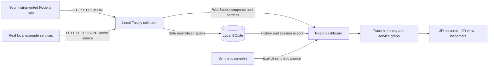

<div align="center">


# TraceVerse

**See your app come alive in 3D.**

An open-source, local application trace explorer powered by OpenTelemetry.

[Quick start](#quick-start) · [Connect your app](docs/instrumentation.md) · [Architecture](docs/architecture.md) · [Privacy](docs/privacy.md) · [Contribute](CONTRIBUTING.md)

</div>

TraceVerse turns spans from your Node.js application into an interactive service universe. Follow requests between services, inspect trace hierarchies and duration waterfalls, and find observed errors and slow operations. The collector, database, dashboard, and example services run on your computer. No account, subscription, cloud database, or paid API is required.

## Quick start

Install **Node.js 24 LTS** and Git, then run:

```sh
git clone https://github.com/prohz189hh-boop/traceverse.git
cd traceverse
npm install
npm run demo
```

Open **http://127.0.0.1:5173**. The command starts the dashboard, the collector at **http://127.0.0.1:4318**, and the real instrumented example services on ports **4600–4604**. Keep the terminal open; press `Ctrl+C` to stop the processes. See [the demo guide](docs/demo.md) for deterministic scenarios and optional framework examples.

Dependencies need internet access during installation. Once installed, the application and examples work locally without internet access. Docker is optional and is not needed for this setup.

To connect your own application without the example services:

```sh
npm run dev
```

For the built application:

```sh
npm run build
npm start
```

Open **http://127.0.0.1:4318** for the production dashboard. See [installation and Windows troubleshooting](docs/installation.md) for runtime requirements, ports, persistence, and development commands.

## What v0.1.0 provides

- A 3D service graph with stable positions, selectable services and connections, directional activity, camera controls, search, filters, and a simpler 2D view.
- Official OpenTelemetry instrumentation helpers for Node.js HTTP and Express, plus a Fastify-owned plugin integration; **OTLP/HTTP JSON trace ingestion** at `/v1/traces`.
- Trace and error inspection, span hierarchy, duration waterfall, observed p50/p95 latency, and incoming/outgoing dependencies.
- Four explicit modes: **Live** for your telemetry, **Demo** for real example requests, **Synthetic** for generated interface samples, and **Replay** for history or imported sessions.
- Local SQLite history, retention controls, deletion, session export/import, replay speed, and a timeline.
- Graphics controls, reduced motion, and accessible HTML service and trace controls alongside the scene.
- A local multi-service example with successful requests, slow SQLite operations, failed requests, and recovery.

The graph only shows entities and dependencies supported by received spans. A database node represents an observed database span; it is not a database inventory scanner. Activity indicators describe recently observed telemetry, not a service uptime guarantee.

## Connect a real application

TraceVerse's SDK uses the official OpenTelemetry Node SDK and **JSON HTTP exporter**. Start tracing before importing the application framework:

```ts
// instrumentation.ts
import { startTracing } from '@traceverse/sdk';

export const tracing = startTracing('my-api', {
  endpoint: 'http://127.0.0.1:4318/v1/traces',
});
```

Load this file before your server with Node's `--import` option. The helper belongs to this npm workspace; for an external project, use the local package setup or direct official exporter configuration in [the integration guide](docs/instrumentation.md). This release does not depend on an npm registry publication of `@traceverse/sdk`.

| Application  | Integration boundary                                                                             |
| ------------ | ------------------------------------------------------------------------------------------------ |
| Node.js HTTP | Server/client spans from official HTTP instrumentation                                           |
| Express      | HTTP spans and Express route/middleware spans                                                    |
| Fastify      | HTTP spans and Fastify handler spans                                                             |
| Next.js      | Next.js 16.4.0 Node runtime `instrumentation.ts`; local webpack development integration verified |

See [copy-paste integrations and supported versions](docs/instrumentation.md). Browser tracing, arbitrary framework discovery, metrics, logs, OTLP/gRPC, and binary Protobuf ingestion are outside v0.1.0.

## Explore the universe

Select a service or connection to inspect recent observed spans, errors, latency, and dependencies. Use trace details to see parent/child relationships and duration bars. Search and category filters help with larger graphs; reduced motion and 2D view reduce rendering cost.

**Live**, **Demo**, and **Synthetic** spans are labeled and kept distinct in the dashboard. **Replay** shows historical data and must not be interpreted as current traffic. Synthetic examples exist only to explore the interface. The Demo mode is fed by actual local instrumented services, including a simulated external dependency that runs on your computer.

Percentiles and counts are calculated over the bounded set of retained/displayed spans. One request can create many spans. Span counts are **not request throughput**, and error-span percentages are **not request error rates**. Incomplete, sampled, or expired traces can hide parent spans and dependencies.

## Architecture



The npm workspaces separate the dashboard, collector, normalization/graph logic, SDK, visualization, and example services. See [architecture](docs/architecture.md) and the [collector API](docs/api.md).

## Performance and limits

Defaults retain at most **10,000 spans** for **60 minutes**. The collector caps payload size and request rates, deduplicates spans, and bounds WebSocket buffering. Settings expose retention and visual limits. Lower graphics quality, reduce particles, enable reduced motion, or use 2D when your device struggles.

The 3D scene uses WebGL; graphics support and performance vary by browser, driver, and hardware. This release has no cross-device frame-rate claim or large-cluster benchmark. It is a local development tool, not an authenticated multi-user production monitoring service.

## Privacy and security

The collector binds to loopback by default and checks Host/origin headers. It rejects malformed or oversized payloads and only keeps selected safe attributes. Request/response bodies, authorization headers, and environment variables are not intentionally collected. URL query strings are removed during normalization.

Service names, operation names, and retained exception types can still contain sensitive text supplied by your instrumentation. Exception messages and stack traces are discarded. Review session exports before sharing them. Exports are JSON files, not encrypted archives. Learn how data is stored and deleted in [privacy](docs/privacy.md), and report vulnerabilities using [SECURITY.md](SECURITY.md).

## Development and validation

```sh
npm ci
npm run check
npx playwright install chromium
npm run test:e2e
npm run test:next
```

`check` runs type checking, linting, unit/integration tests, and production builds. Browser tests start the real demo automatically. `test:next` checks the optional local Next.js example separately. Test commands and coverage boundaries are explained in [contributing](CONTRIBUTING.md).

The Node.js HTTP, Express demo, Fastify 5.12.7, and Next.js 16.4.0 Node runtime integrations have been exercised locally on Windows with Node 24.20.0. Next.js verification uses webpack development mode and a genuine checkout/database trace reaching the collector; Edge, deployed/serverless, and Next.js production builds are outside that verification.

GitHub Actions runs checks on Windows, Linux, and macOS, plus Chromium browser tests on Linux. A configured workflow is not a claim that every platform has already passed; see workflow results and [PROGRESS.md](PROGRESS.md) for recorded local verification.

## Roadmap

v0.1.0 focuses on local Node.js traces and a bounded interactive explorer. Future work includes binary OTLP/HTTP support, broader framework fixtures, richer trace querying, better large-graph layouts, export redaction controls, and measured graphics budgets. Metrics/logs, browser instrumentation, and remote authenticated deployment need separate design and validation.

Ideas and improvements are welcome through [issues](https://github.com/prohz189hh-boop/traceverse/issues). Please distinguish implementation bugs from missing telemetry and attach a small sanitized reproduction.

## Contributing and license

Read [CONTRIBUTING.md](CONTRIBUTING.md), [CODE_OF_CONDUCT.md](CODE_OF_CONDUCT.md), and [SECURITY.md](SECURITY.md). TraceVerse's own code is released under the [MIT license](LICENSE). Third-party packages retain their own licenses; see [third-party notices and reviewed dependency licenses](docs/licenses.md).
