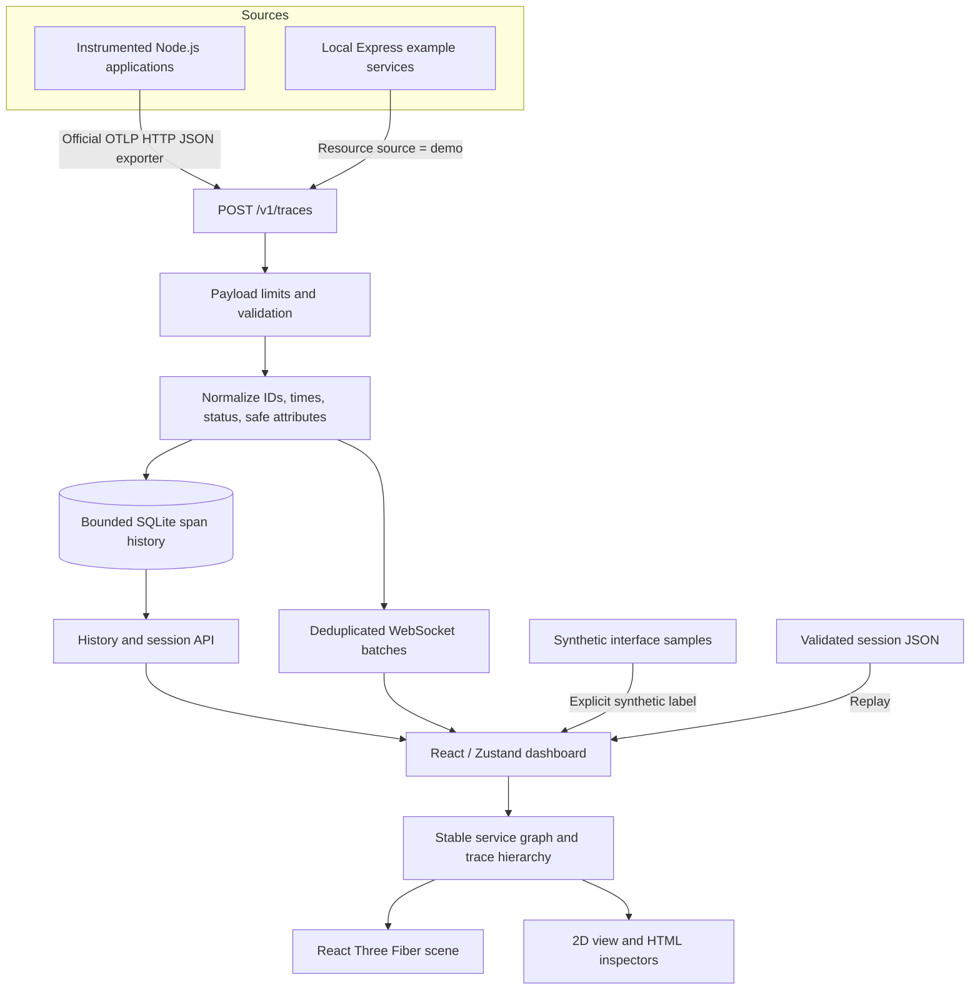

# Architecture

TraceVerse is one local npm-workspace application. It observes instrumented applications; it does not discover processes or inspect arbitrary network traffic.

## Workspace boundaries

| Directory                | Responsibility                                                                                                       |
| ------------------------ | -------------------------------------------------------------------------------------------------------------------- |
| `apps/web`               | Vite/React dashboard, local preferences, transport connection, mode selection, inspectors, and replay                |
| `apps/collector`         | Fastify HTTP API, ingestion validation, WebSocket delivery, SQLite retention, and serving the built dashboard        |
| `packages/core`          | Shared normalized types, safe attributes, OTLP JSON decoding, session validation, service graph, and trace utilities |
| `packages/sdk`           | Official OpenTelemetry Node SDK setup and trace export helpers                                                       |
| `packages/visualization` | Reusable interactive graph rendering                                                                                 |
| `packages/config`        | Shared TypeScript configuration                                                                                      |
| `examples/express-demo`  | Real local HTTP service requests and database/dependency examples                                                    |
| `examples/nextjs-demo`   | Optional Next.js Node runtime integration fixture                                                                    |
| `tests`                  | Integration and browser fixtures                                                                                     |
| `scripts`                | Cross-platform process startup, build, verification, and release helpers                                             |

Development uses Vite on loopback port 5173 and the collector on 4318. A production build bundles the dashboard with Vite and the collector with esbuild; `npm start` serves both UI and API from 4318. SQLite comes from Node's built-in `node:sqlite`, avoiding a separately installed database server or native npm database build.

## Trace model

Normalized spans retain a hexadecimal trace ID, span ID, optional parent span ID, service name, operation, millisecond start time and duration, span kind, status, safe attributes, limited events, and an explicit data source. OTLP timestamps arrive as Unix nanoseconds and are converted to milliseconds for storage/rendering.

Span identity is `traceId:spanId`. Repeated exports do not increase the count for that identity. The collector bounds stored history by count and age; the browser also bounds its working set. Missing spans stay missing. A partial trace can contain a child whose parent was not sampled, exported, or retained.

The service graph joins parent and child spans within a trace when they belong to different services. Supported database and client attributes can create database or external dependency nodes. No dependency is added merely because its name appears in a configuration file. Positions are deterministic so a service does not jump around on every batch.

## Statistics and animation

Counts, error counts, p50, and p95 are derived from the available span set. Percentiles are empirical samples over span durations. They do not account for missing telemetry, provide request-level throughput, or establish availability/SLO compliance.

Animations reflect the received spans and graph relationships. Low-quality and reduced-motion settings lower rendering work; an HTML service list and 2D view provide an alternative to interacting with WebGL. The scene is not a timeline-accurate packet simulator.

## Sources and replay

`live`, `demo`, and `synthetic` are span source labels. The SDK sets the source through a resource attribute; the local example uses `demo`. Synthetic spans are generated in the interface and labeled accordingly. Source labels are provenance hints supplied by the local producer, not an authentication mechanism.

Replay is a dashboard viewing mode. It displays recorded/imported spans using their original timestamps; it does not emit application requests. Session imports are validated and re-sanitized before use. See [the API](api.md) for the session format and [privacy](privacy.md) for deletion behavior.

## Transport and trust boundary

Only trace **OTLP/HTTP JSON** is accepted at `/v1/traces` in v0.1.0. OTLP also defines binary Protobuf and gRPC transports; accepting JSON does not imply support for those formats. See the [official OTLP specification](https://opentelemetry.io/docs/specs/otlp/#otlphttp) and [exporter configuration](https://opentelemetry.io/docs/languages/sdk-configuration/otlp-exporter/).

The collector is intended for one local user: loopback binding, restricted Host/origin checks, request/payload limits, and bounded client buffers. There is no remote identity or tenancy system. See [security](../SECURITY.md).

## Dependency decisions

- React 19 is paired with React Three Fiber 9. The [official v9 migration guide](https://r3f.docs.pmnd.rs/tutorials/v9-migration-guide) identifies v9 as the React 19 compatibility release.
- OpenTelemetry's official Node SDK, HTTP/Express instrumentations, and JSON HTTP exporter provide trace context propagation rather than a home-grown tracing protocol.
- Fastify, WebSockets, and built-in SQLite keep the collector local and operational without cloud services.
- Vitest and Playwright check pure behavior, collector integration, and actual browser interactions. Configured operating-system CI targets remain separate from locally observed verification results.

This release favors bounded local behavior. Large-cluster layout, binary OTLP, metrics/logs, authenticated network deployment, and GPU performance budgets remain roadmap work.
