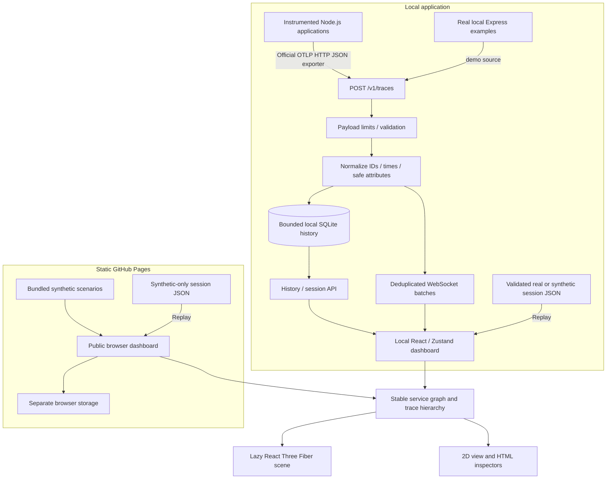

# Architecture

TraceVerse is an npm-workspace application with two builds that share the dashboard, trace model, and visualization. The local build observes instrumented applications; the static public build explores bundled synthetic spans. Neither discovers arbitrary running processes or inspects network traffic.

## Workspace boundaries

| Directory                | Responsibility                                                                                                       |
| ------------------------ | -------------------------------------------------------------------------------------------------------------------- |
| `apps/web`               | Vite/React dashboard, local preferences, transport connection, mode selection, inspectors, and replay                |
| `apps/collector`         | Fastify HTTP API, ingestion validation, WebSocket delivery, SQLite retention, and serving the built dashboard        |
| `packages/core`          | Shared normalized types, safe attributes, OTLP JSON decoding, session validation, service graph, and trace utilities |
| `packages/sdk`           | Official OpenTelemetry Node SDK setup and trace export helpers                                                       |
| `packages/visualization` | Reusable interactive graph rendering                                                                                 |
| `packages/config`        | Shared TypeScript configuration                                                                                      |
| `examples/express-demo`  | Real local HTTP service requests and database/dependency examples                                                    |
| `examples/nextjs-demo`   | Optional Next.js Node runtime integration fixture                                                                    |
| `tests`                  | Integration and browser fixtures                                                                                     |
| `scripts`                | Cross-platform process startup, build, verification, and release helpers                                             |

Development uses Vite on loopback port 5173 and the collector on 4318. A production build bundles the dashboard with Vite and the collector with esbuild; `npm start` serves both UI and API from 4318. SQLite comes from Node's built-in `node:sqlite`, avoiding a separately installed database server or native npm database build.

## Static build and routing

`npm run build:demo` builds the existing dashboard in public-demo mode to `apps/web/dist-public`. Vite's base is `/traceverse/`, so assets and lazy imports resolve beneath the GitHub repository path. The Pages workflow uploads this output; it does not upload/run collector or example-service code. `npm run preview:demo` serves the same output on loopback port 4173.

The build flag changes the data boundary: Synthetic is the default, Live/Demo and collector configuration are unavailable, collector API/WebSocket transport is not started, and imported/saved replay records must all have source `synthetic`. Public preferences and sessions use separate storage keys. This is a static interface demonstration, not a remote monitoring service.

Navigation uses `#/universe`, `#/services`, `#/traces`, `#/errors`, `#/performance`, `#/sessions`, and `#/docs`. Only the fragment changes; the host keeps serving `/traceverse/`. Direct `/traceverse/traces` server paths are not the documented deep-link format. Static tests verify asset loading, fragment navigation, synthetic provenance, and absence of collector traffic.

## Trace model

Normalized spans retain a hexadecimal trace ID, span ID, optional parent span ID, service name, operation, millisecond start time and duration, span kind, status, safe attributes, limited events, and an explicit data source. OTLP timestamps arrive as Unix nanoseconds and are converted to milliseconds for storage/rendering.

Span identity is `traceId:spanId`. Repeated exports do not increase the count for that identity. The collector bounds stored history by count and age; the browser also bounds its working set. Missing spans stay missing. A partial trace can contain a child whose parent was not sampled, exported, or retained.

The service graph joins parent and child spans within a trace when they belong to different services. Supported database and client attributes can create database or external dependency nodes. No dependency is added merely because its name appears in a configuration file. Positions are deterministic so a service does not jump around on every batch.

## Statistics and animation

Counts, error counts, p50, and p95 are derived from the available span set. Percentiles are empirical samples over span durations. They do not account for missing telemetry, provide request-level throughput, or establish availability/SLO compliance.

Animations reflect the available spans and graph relationships. Synthetic scenarios produce actual normalized span records for each visible relationship; the renderer does not add decorative service dependencies. Slow/error highlights come from span duration/status evidence, while the recovery scenario demonstrates subsequent successful work.

The 3D component is loaded on demand. Low, balanced, and high presets trade visual density for rendering work; balanced is the default. Paused, idle, and reduced-motion scenes can settle instead of rendering continuously, while camera/selection/data changes request updates. Geometries/materials are reused or cleaned up, histories and node counts are bounded, and optional particles have configurable limits. An HTML service list and 2D view provide an alternative to WebGL. Animation is a visual explanation of observed activity, not a timeline-accurate packet simulator. [Performance measurements](performance.md) describe what has actually been measured.

## Sources and replay

`live`, `demo`, and `synthetic` are span source labels. The SDK sets the source through a resource attribute; the local example uses `demo`. Synthetic spans are generated in the interface and labeled accordingly. Source labels are provenance hints supplied by the local producer, not an authentication mechanism.

Replay is a dashboard viewing mode. It displays recorded/imported spans using their original timestamps; it does not emit application requests. Session imports are validated and re-sanitized before use. The public build additionally rejects any nonsynthetic span, including mixed-source sessions; local replay still supports real records. See [the API](api.md) for the session format and [privacy](privacy.md) for deletion behavior.

## Transport and trust boundary

Only trace **OTLP/HTTP JSON** is accepted at the local `/v1/traces` endpoint in v0.2.0. OTLP also defines binary Protobuf and gRPC transports; accepting JSON does not imply support for those formats. See the [official OTLP specification](https://opentelemetry.io/docs/specs/otlp/#otlphttp) and [exporter configuration](https://opentelemetry.io/docs/languages/sdk-configuration/otlp-exporter/).

The collector is intended for one local user: loopback binding, restricted Host/origin checks, request/payload limits, and bounded client buffers. There is no remote identity or tenancy system. See [security](../SECURITY.md).

## Dependency decisions

- React 19 is paired with React Three Fiber 9. The [official v9 migration guide](https://r3f.docs.pmnd.rs/tutorials/v9-migration-guide) identifies v9 as the React 19 compatibility release.
- OpenTelemetry's official Node SDK, HTTP/Express instrumentations, and JSON HTTP exporter provide trace context propagation rather than a home-grown tracing protocol.
- Fastify, WebSockets, and built-in SQLite keep the collector local and operational without cloud services.
- Vitest and Playwright check pure behavior, collector integration, and actual browser interactions. Configured operating-system CI targets remain separate from locally observed verification results.

This release favors bounded local behavior and a small public synthetic example. Large-cluster validation, binary OTLP, metrics/logs, and authenticated network deployment remain roadmap work. Measurements on one browser/renderer do not establish a universal GPU performance budget.
